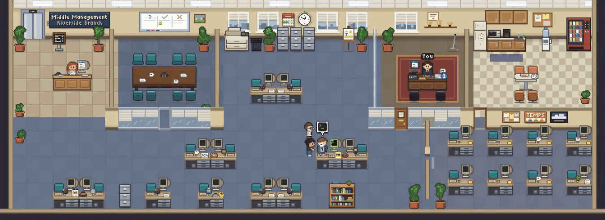
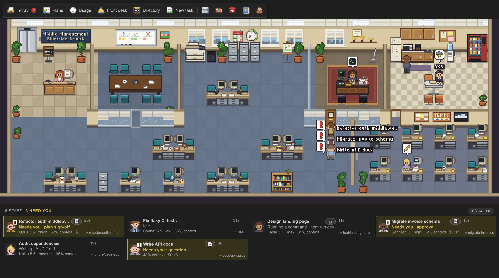
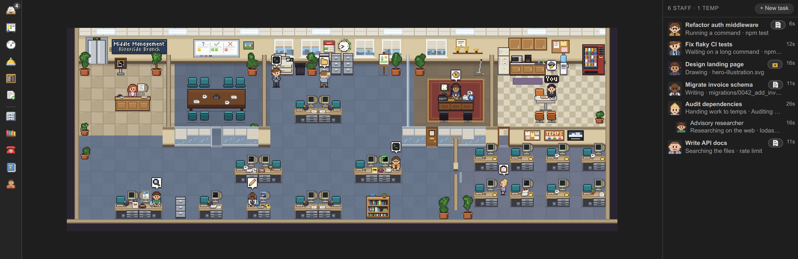
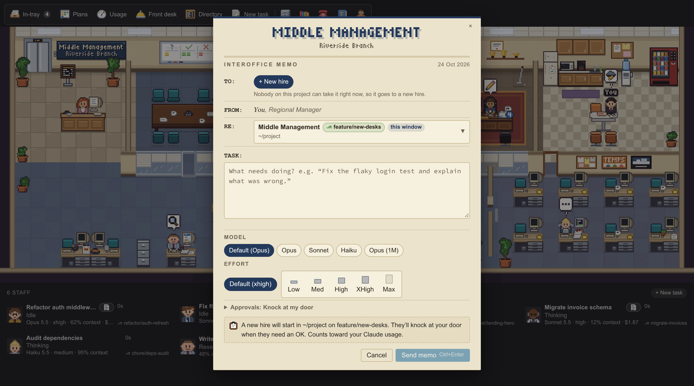
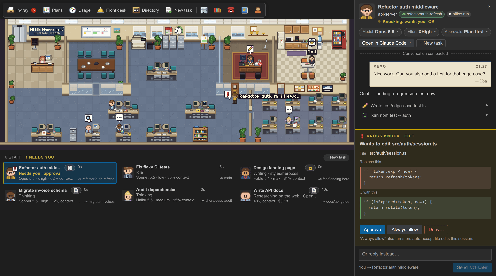
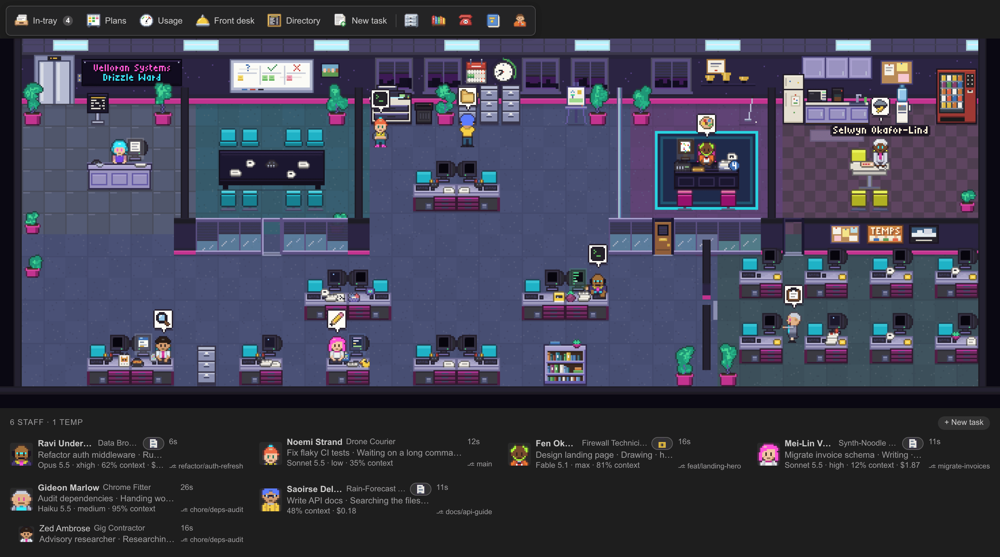

# Middle Management

[](https://github.com/Barniclebazil/middle-management/actions/workflows/ci.yml)

A VS Code and VSCodium extension that turns your running Claude Code agents into staff at a pixel-art paper company. You're the Regional Manager, watching from the glass-walled office while your agents type, rummage, wait at the copier and knock on your door when they need you.



> Middle Management is an independent project and is not affiliated with or endorsed by Anthropic. "Claude" and "Claude Code" are Anthropic's names, used only to say what the extension works with. The office and its characters are original.

## What it does

Every Claude Code session gets a desk, and what the agent is doing shows in what its worker does. Subagents are temps: they walk in from the lift, do their bit and go home.

| Agent is... | Worker... |
| --- | --- |
| reading files | holds a printout up at their desk |
| searching | rummages in the filing cabinets |
| writing code | types fast |
| running a long command | waits at the copier, tapping a foot |
| planning | writes on the conference-room whiteboard |
| thinking | leans back with a thought bubble |
| needing your permission or an answer | walks to your door and knocks |
| compacting its context | feeds the shredder |
| idle | chats at the water cooler |

There are a few more poses; the [user guide](docs/guide.md#what-the-workers-do) has the full list. Speech bubbles show the file or command a worker is busy with, and hovering over anyone shows their session, project, branch, model and how full their context is.



The office has a life of its own, too. Desks are handed out by model, so Opus sits near you and Haiku out in the annex. Workers sip coffee faster the harder they think. A cleaner wipes down desks after people leave, a food cart comes round, and two IT support staff wander in to ask whether you've tried turning it off and on again. And if a Fable worker turns up, they take over your office for five minutes while you sulk at the kitchen table. The [user guide](docs/guide.md#office-life-between-tasks) has the details.

### Made for a strip above your editor

The first time you open it, the office moves VS Code's panel to the top of the window, where a wide, short strip suits it best. In that shape the toolbar becomes a rail down the left and the staff list runs alongside the map. Clicking a worker opens their conversation in an editor tab.



If you'd rather have it somewhere else, right-click the panel title and choose **Panel Position**. It also works in a sidebar or as an editor tab.

### Office tools

The icon bar along the top gives you a few handy things, each tied to a prop in the office:

- **In-tray** for finished reports, plans waiting for sign-off, questions and approvals.
- **Plans** on the whiteboard, to read and approve or send back.
- **Usage** on the wall clock and calendar, showing how much of your Claude plan limits you've used.
- **File room**, a read-only browser for your project files.
- **Training library** for your skills and slash commands, **Phone** for your MCP servers, **Office handbook** for your CLAUDE.md files, memory and permission rules, and **Temp agency** for the subagent types you can hire.

See [Office tools](docs/guide.md#office-tools) in the guide for what each one shows.

## Getting started

1. Download `middle-management-<version>.vsix` from the [latest release](https://github.com/Barniclebazil/middle-management/releases/latest).
2. Install it from the Extensions view (`...` menu, **Install from VSIX...**), or from a terminal:

   ```sh
   code --install-extension middle-management-<version>.vsix
   # VSCodium:
   codium --install-extension middle-management-<version>.vsix
   ```

3. Click the Middle Management icon in the activity bar, or run **Middle Management: Show Office** from the Command Palette.

If Claude Code is running in your workspace, your agents will already be at their desks. If not, run **Middle Management: Toggle Demo** to watch a scripted office go through every pose.

The office can tell you when a new version is out and install it for you. You can also install a newer `.vsix` the same way as above.

## Manager Mode

Watching is only half the job. In Manager Mode you can hand out tasks, read conversations and answer questions without leaving the office. It uses the Claude Agent SDK to run real Claude Code sessions.

To give a task, click yourself in the glass office or use **+ New task**. You fill in an interoffice memo: which project, what to do, whether it goes to a new hire or an existing worker, and optionally the model, effort level and how much approval you want.



Click any worker to open their case file: your memos, their replies and each step they took. You can reply, queue up the next instruction, stop them, or change their model and effort. When a worker needs permission, they knock on your door, and the card shows exactly what they want to do, with **Approve**, **Always allow** and **Deny**. Questions and plans come in the same way.



A few things worth knowing:

- Tasks run on your own Claude Code login and count toward your Claude usage, as if you'd run them in Claude Code yourself. Watching is free.
- Manager Mode never bypasses permissions. Your normal Claude Code permission rules and project settings apply, and workers only knock for things Claude Code would ask you about anyway.
- It won't drive a session that's open in another window. You can still read it here and carry on in that window.
- Workers started from the office run inside your editor window, so reloading or closing the window stops them. You can pick them up again from the office afterwards.

If you'd rather just watch, switch to **view mode**, a read-only office that shows your own sessions and never runs anything. Everything else about Manager Mode, including costs and plan mode, is in the [user guide](docs/guide.md#manager-mode).

## Make it your own

Click the receptionist to open the Front desk, where you can rename the company, change everyone's names and looks, recolour the rooms and tweak the settings.

For bigger changes, there are six ready-made offices (an example office plus a spaceship, a construction site, a metalwork factory, a cyberpunk tower and a steampunk counting house), and you can write your own theme file with names, job titles, small talk and colours. Run **Middle Management: Create Theme File** to start one.



You don't even have to write it yourself. Choose **Teach Claude** on the Front desk's Theme tab, then ask Claude Code something like "Make me a Middle Management theme set on a pirate ship where everyone talks like a pirate." The [theme guide](docs/themes.md) covers all of it.

## Commands

All of these are in the Command Palette under **Middle Management:**

- **Show Office** and **Open in Editor Tab**
- **New Task**
- **Open Front Desk**
- **Toggle Demo**
- **Put the office on top**
- **Switch Between View and Manager Mode**
- **Create Theme File**
- **Check for Updates**

## Settings

Everything lives under `claudeOffice.*`, and most of it can be changed from the Front desk.

| Setting | Default | What it does |
| --- | --- | --- |
| `claudeOffice.scope` | `workspace` | Show this workspace's sessions, or `all` on the machine |
| `claudeOffice.mode` | `manager` | `manager` for the full office, `view` for read-only |
| `claudeOffice.sendHomeAfter` | `8` | Hours before idle workers go home (`0` never) |
| `claudeOffice.companyName` | `Middle Management` | Company name on the wall sign |
| `claudeOffice.branchName` | `Riverside Branch` | Second line of the sign |
| `claudeOffice.speechBubbles` | `true` | Show what workers are busy with |
| `claudeOffice.managerName` | `You` | Your name in the office |
| `claudeOffice.bossQuotes` | `true` | Let the manager say the occasional boss-ism |
| `claudeOffice.usageChecks` | `auto` | Check your plan usage, or `off` |
| `claudeOffice.updateChecks` | `auto` | Check GitHub daily for a new release, or `off` |
| `claudeOffice.claudePath` | empty | Path to the `claude` executable for Manager Mode |
| `claudeOffice.themeFile` | empty | Theme file, or a ready-made office such as `preset:cyberpunk` |

The [user guide](docs/guide.md#settings) has the longer descriptions.

## Privacy

Middle Management runs entirely on your machine.

- To show the office, it reads Claude Code's local files under `~/.claude` (or `CLAUDE_CONFIG_DIR` if you set it). It never changes them, and it never reads your credentials, session keys or history.
- There's no telemetry, no server and no open ports.
- The only network request it makes itself is an optional daily update check to GitHub, which sends nothing about you. Set `claudeOffice.updateChecks` to `off` to stop it.
- The usage meter briefly starts Claude Code with no prompt, which uses no tokens. Set `claudeOffice.usageChecks` to `off` to stop that too.
- Manager Mode starts Claude Code processes only when you give it a task.

The guide lists [every file it reads](docs/guide.md#privacy-in-detail) and [everything it starts in the background](docs/guide.md#what-starts-in-the-background).

## Requirements

- VS Code 1.90 or later, or VSCodium.
- Claude Code, installed and run at least once on the same machine. Manager Mode also needs you to be logged in.
- Linux and Windows are supported. macOS should work but hasn't been tested.

It installs on Windows without admin rights, which helps on a locked-down work PC. See [Windows 11 without admin rights](docs/guide.md#windows-11-without-admin-rights), and [Claude Code in WSL](docs/guide.md#claude-code-in-wsl) if your agents run inside WSL. If something isn't working, try [Troubleshooting](docs/guide.md#troubleshooting).

## Building from source

You need Node 22.18 or later and npm.

```sh
git clone https://github.com/Barniclebazil/middle-management.git
cd middle-management
npm install
npm run build        # dev build into dist/
npm test             # unit tests (node --test)
npm run typecheck
npm run package      # produces middle-management-<version>.vsix
```

Press F5 in VS Code to start an Extension Development Host. There's also a browser harness for working on the art; see [Development](docs/guide.md#development) in the guide. Code conventions are in [CONTRIBUTING.md](CONTRIBUTING.md).

## License

MIT. See [LICENSE](LICENSE).

Claude and Claude Code are trademarks of Anthropic, PBC. This project is not affiliated with, endorsed by or licensed by Anthropic.

Middle Management was inspired by the Agent Standup extension's idea of visualising agents. No code or art from that project is used.
